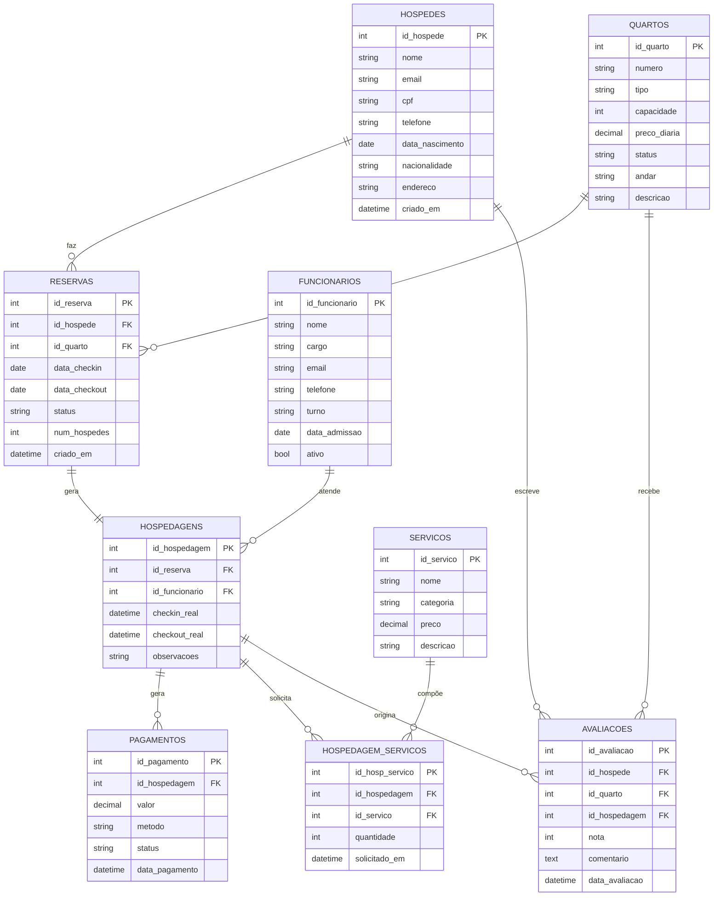

# Parte 1 — Diagrama Entidade-Relacionamento

## Diagrama ER (Mermaid)

---

> Para visualizar o diagrama, cole o bloco Mermaid em [mermaid.live](https://mermaid.live) ou use qualquer editor com suporte a Mermaid (VS Code, GitHub, Notion).
